# 🐙 PROJECT OCTOPUS — V1 Official Deck Skeleton (10 Core Slides + Appendix)

Ce document est le **squelette V1 en anglais** (max 10 slides principales + Appendix pour les fiches détaillées des 10 Use Cases de tes collègues), structuré exactement selon les **5 grandes catégories validées par ton chef**.

Les zones marquées **`[TO COMPLETE WITH TEAM: ...]`** indiquent exactement ce que toi et tes collègues devez remplir ensemble.

---

## 🗺️ V1 Master Structure (10 Slides + Appendix)

### 📁 SECTION 1 — EXECUTIVE SUMMARY & WHY NOW?
* **Slide 1 — Executive Summary & The Ask** *(Garde ta slide avec la roue des 10 ronds verts + résumé de la demande)*
* **Slide 2 — Why Now? From Proven Local Tools to a Unified Platform** *(Le constat : les outils sont déjà utilisés par le métier mais tournent en silo)*

### 📁 SECTION 2 — PROJECT OCTOPUS: USE CASES SUMMARY & FUTURE VALUE
* **Slide 3 — Portfolio Summary: The 10 Use Cases & Current Business Adoption** *(La vue d'ensemble des 10 modules, qui les utilise déjà, et pourquoi ils intéressent le business — le détail de chaque module part en Appendix)*
* **Slide 4 — Future Value Proposition: "Collect Once, Enrich Once, Serve Many"** *(Les bénéfices concrets : fin des doublons, mémoire partagée, valeur croisée entre les modules)*

### 📁 SECTION 3 — ARCHITECTURE: AS-IS vs. TO-BE (HIGH-LEVEL)
* **Slide 5 — Architecture As-Is: Siloed Execution & Redundant Flows** *(Ton schéma Daily Threat Intel actuel comme exemple de pipeline isolé)*
* **Slide 6 — Target High-Level Architecture (To-Be): External vs. Internal Boundary & AI Agent Layer** *(Ta Slide 18 simplifiée : montre clairement ce qui est Externe vs Interne, le flux strictement unidirectionnel External $\rightarrow$ Internal, et ce que fait l'Agent IA au-dessus des modules)*

### 📁 SECTION 4 — PROCESS, METHODOLOGY & TOOLING
* **Slide 7 — How We Streamline: Process Standardization & AI Agent Role** *(La méthodologie simple en 4 étapes et le rôle exact de l'IA)*
* **Slide 8 — Target Toolkit & Governance Stack** *(Les briques d'outils choisies pour remplacer le bricolage manuel)*

### 📁 SECTION 5 — GAPS, NEEDS, FUNDING & ROADMAP
* **Slide 9 — Token Economics & Funding Details** *(Consommation actuelle de crédits/tokens vs économies grâce à la BDD partagée)*
* **Slide 10 — Current Gaps, What We Need (The Ask) & Phased Roadmap** *(Ce qui nous manque aujourd'hui, ce dont on a besoin pour avancer, et les 3 vagues)*

### 📎 APPENDIX — DEEP DIVE ON THE 10 USE CASES
* **Slides A1 to A10 — Individual Use Case Cards** *(1 slide par module faite par toi et tes collègues)*

---

## 📝 Slide-by-Slide Skeleton (English — Ready to Fill with the Team)

---

### SLIDE 1 — Executive Summary & The Ask
* **Section:** `1. Executive Summary & Why Now?`
* **Visual to Keep:** 🟢 **Ta slide actuelle avec le rond central `Octopus platform` et les 10 bulles vertes autour.**
* **Content Skeleton (On the side or bottom of the wheel):**
  * **Project Vision:** Merge **10 existing and emerging intelligence & monitoring workflows** into **Octopus**—a single, unified software platform hosted on the internal corporate cloud.
  * **Proven Business Traction:** Several key modules (*Daily Threat Intel*, *Adverse News*, *Newsletters*, etc.) are **already live and actively used by business & risk teams daily**, proving strong operational value.
  * **The Ask (What We Need Validated):**
    1. Approval to consolidate all 10 initiatives under a single shared internal architecture & database.
    2. Allocation of internal Cloud hosting & centralized AI API budget (`[TO COMPLETE WITH TEAM: Estimated €/$ or Token budget]`).
    3. Support to transition from local/manual pipelines to an industrialized team toolkit.

---

### SLIDE 2 — Why Now? Scaling Proven Business Initiatives Safely
* **Section:** `1. Executive Summary & Why Now?`
* **Objective:** Explain why we must act now (we passed the POC stage; business teams rely on our outputs, so we can no longer run on personal PCs or isolated scripts).
* **Content Skeleton (3 Blocks):**
  * **1. High Business Demand, Fragmented Delivery:**
    * Business stakeholders already rely on our intelligence outputs (`[TO COMPLETE WITH TEAM: List 2-3 business teams currently reading your reports]`).
    * However, modules were built organically by different team members using separate scripts, local PCs, and manual pipelines.
  * **2. Operational & "Shadow IT" Risks:**
    * Semi-monitored execution (local crons, flat JSON files) creates **Key-Person Dependency** and maintenance bottlenecks.
    * Lack of unified governance as the portfolio grows to 10 distinct modules.
  * **3. Duplicate Effort & Redundant AI Costs:**
    * Without a shared database, multiple modules scrape the same external sources and pay for LLM tokens multiple times to analyze the exact same news or cyber event.

---

### SLIDE 3 — Portfolio Summary: The 10 Use Cases & Current Business Adoption
* **Section:** `2. Project Octopus: Use Cases & Future Value`
* **Objective:** Give a high-level summary of the 10 modules inside the main deck (linking what is **already used by the business** to prove value), while pointing to the **Appendix** for technical details.

| # | Octopus Module | Key Business Interest / Output | Current Status | Currently Used By (Business Link) |
| :-: | :--- | :--- | :---: | :--- |
| **1** | **Daily Threat Intel** | Daily cyber threat & vulnerability executive digest + incident/control tracking. | 🟢 **Live (Daily)** | Cyber / Threat Intel Teams *(On PC/GitHub)* |
| **2** | **Adverse News** | Automated negative media screening (fraud, litigation, reputation, cyber). | 🟢 **Live (Daily)** | Risk & Compliance Teams *(On PC)* |
| **3** | **AI & Digital Asset Newsletter** | Curated strategic watch on AI trends, crypto, and digital assets. | 🟢 **Live (Weekly)** | `[TO COMPLETE: Target audience]` |
| **4** | **Intelligence Alerts** | Flash alerts on critical threats requiring immediate attention. | 🟡 **Active / Semi-Manual** | `[TO COMPLETE: Target audience]` |
| **5** | **EASM Platform** | External Attack Surface monitoring & exposed asset tracking. | 🟡 **In Use / To Clean** | `[TO COMPLETE: Target audience]` |
| **6** | **TP Monitoring** | Continuous risk monitoring of critical Third-Party vendors. | 🟡 **In Use / To Clean** | `[TO COMPLETE: Target audience]` |
| **7** | **Sectorial Reports** | Periodic macro & industry-specific risk intelligence syntheses. | 🟡 **Semi-Manual** | `[TO COMPLETE: Target audience]` |
| **8** | **Corporate Client Monitoring** | Risk & news tracking across corporate client portfolios. | 🔴 **To Refactor** | `[TO COMPLETE: Target audience]` |
| **9** | **Regulatory Monitoring** | Tracking new banking regulations & guidelines (DORA, EBA, etc.). | 🔴 **To Refactor** | `[TO COMPLETE: Target audience]` |
| **10** | **UK Bank Risk Monitoring** | Dedicated watch on UK banking sector, PRA/FCA & market risks. | 🔴 **To Refactor** | `[TO COMPLETE: Target audience]` |

> 📌 *Note at the bottom of Slide 3: Detailed functional sheets for each of the 10 use cases are available in the **Appendix**.*

---

### SLIDE 4 — Future Value Proposition: Why Merge into Octopus?
* **Section:** `2. Project Octopus: Use Cases & Future Value`
* **Objective:** Explain the concrete future value of merging the 10 modules into a single software platform.
* **Content Skeleton (4 Value Pillars):**
  1. **"Ingest Once, Reuse Everywhere" (Shared Memory):**
     * If an external article or event is already stored and summarized in the Octopus Database by *Adverse News*, it is **automatically reused** by *TP Monitoring*, *Corporate Client Monitoring*, and *Sectorial Reports*—**we never generate or pay for the same content twice**.
  2. **Cross-Module Intelligence Correlation (New Business Value):**
     * Linking current use cases together: e.g., automatically matching a cyber breach from *Daily Threat Intel* with our vendor list in *TP Monitoring* and client list in *Corporate Client Monitoring*.
  3. **Unified User Experience:**
     * One single portal and standardized report format for Analysts, Risk Managers, and Directors instead of 10 disconnected tools/emails.
  4. **Zero Shadow IT & Enterprise Reliability:**
     * 100% hosted on internal corporate cloud with centralized monitoring, backup, and access controls.

---

### SLIDE 5 — Architecture As-Is: Siloed Execution & Manual Pipelines
* **Section:** `3. Architecture: As-Is vs. To-Be`
* **Visual to Keep:** 🟢 **Ton schéma vertical `Daily Threat Intel` (Photo n°3 : RSS $\rightarrow$ Python Cron $\rightarrow$ Gemini $\rightarrow$ JSON DB)** placé à gauche comme exemple concret d'un module qui tourne aujourd'hui, avec un encadré à droite résumant les limites du mode "As-Is".
* **Content Skeleton (Right side of the slide — "As-Is Limitations across the 10 Modules"):**
  * **10 Separate Pipelines:** Each module currently fetches external data on its own, runs its own script, and stores results in isolated files (`incidents_db.json`, `controls_db.json`, Excel, Markdown).
  * **Fragmented AI Usage:** Different modules use different AI models/prompts without a shared cache or centralized token tracking.
  * **No Shared Database:** Information extracted by one module cannot be queried by another module.

---

### SLIDE 6 — Target High-Level Architecture (To-Be): External vs. Internal & AI Agent Layer
* **Section:** `3. Architecture: As-Is vs. To-Be`
* **Visual to Keep & Adapt:** 🟢 **Ta Slide 18 (`TARGET ARCHITECTURE`, Photo n°1)** adaptée en mode **High-Level** pour répondre exactement aux 3 consignes de ton chef :
  1. Montrer clairement la frontière **EXTERNAL WORLD** vs **INTERNAL BNPP CLOUD**.
  2. Montrer que le flux est **100% UNIDIRECTIONNEL (`EXTERNAL` $\rightarrow$ `INTERNAL`, JAMAIS l'inverse)**.
  3. Montrer **ce que fait l'Agent IA ("AI Agent Layer")** au-dessus des modules et de la BDD.

#### Schéma High-Level exact à reproduire sur ta Slide 6 :

```mermaid
flowchart TB
    %% ZONE EXTERNE
    subgraph EXT["🌐 EXTERNAL WORLD (Public Internet & Data Sources)"]
        direction LR
        E1["Global News & Press\n(Reuters, FT, Google News)"]
        E2["Cyber & Threat Feeds\n(RSS, CERTs, NVD/CVEs, Shodan)"]
        E3["Regulatory Publications\n(EBA, ECB, FCA, PRA, Public Filings)"]
    end

    %% BARRIERE DE SECURITE UNIDIRECTIONNELLE
    GATE["🔒 STRICT ONE-WAY INGESTION BOUNDARY (Inbound Only: External ➔ Internal | ZERO Data Sent Outside BNPP)"]

    %% ZONE INTERNE BNPP
    subgraph INT["🏦 INTERNAL BNPP CLOUD INFRASTRUCTURE (Project Octopus)"]
        direction TB
        
        DB[("🗄️ UNIFIED SHARED DATABASE & MEMORY\n• Deduplicated Raw Content\n• Enriched Incidents, Controls & Entities\n• Shared Cache (If already in memory ➔ Immediate Reuse)")]

        subgraph AI["🧠 CENTRAL AI AGENT LAYER (On Top of All Modules)"]
            direction LR
            A1["1. Smart Filtering & Triage\n(Discard noise, keep bank impact)"]
            A2["2. Single-Pass Enrichment\n(Summarize, tag entities/risks once)"]
            A3["3. Cross-Module Correlation\n(Link Cyber + Client + Vendor + Reg)"]
            A4["4. Executive Synthesis\n(Generate structured reports & alerts)"]
        end

        subgraph MOD["🐙 THE 10 OCTOPUS INTELLIGENCE MODULES"]
            direction LR
            M1["Daily Threat\nIntel"]
            M2["Adverse\nNews"]
            M3["TP\nMonitoring"]
            M4["Corporate\nClients"]
            M5["Intel\nAlerts"]
            M6["EASM\nPlatform"]
            M7["Regulatory\nMonitoring"]
            M8["UK Bank\nRisk"]
            M9["Sectorial\nReports"]
            M10["AI & Digital\nNewsletters"]
        end

        UI["🖥️ OCTOPUS UI & API GATEWAY (Internal Access Only: Threat Intel Analysts | Risk Managers | Directors)"]
    end

    EXT ==>|"Read-Only Pull (Inbound Only)"| GATE
    GATE ==> DB
    DB <==> AI
    AI <==> MOD
    MOD ==> UI
```

* **3 Key Callouts to highlight on Slide 6:**
  * 🔒 **Strict One-Way Data Flow (`External ➔ Internal Only`):** Octopus only pulls public/external feeds inward. **Zero internal data, client lists, or prompts ever leave BNPP infrastructure.**
  * 🗄️ **Shared Database & Memory:** Every incoming article is checked against the internal DB first. If already present, it is reused without re-running AI extraction.
  * 🧠 **What the AI Agent Does on Top of the Modules:** Acts as a single intelligent brain that filters noise, extracts structured entities/incidents once, correlates events across modules, and drafts tailored reports.

---

### SLIDE 7 — Process & Methodology: How We Streamline the Workflow
* **Section:** `4. Process, Methodology & Tooling`
* **Objective:** Explain the standardized 4-step process that replaces manual/ad-hoc work across all 10 modules.
* **Content Skeleton (4 Horizontal Steps):**
  * **Step 1 — Automated Inbound Collection & Deduplication:**
    * Scheduled collectors pull external feeds into the internal zone and check if the content already exists in the Shared DB (`Hash / Memory Check`).
  * **Step 2 — AI Agent Filtering & Single-Pass Extraction:**
    * If the content is new, the internal AI Agent applies business rules to discard noise and extracts a standardized record (`Summary`, `Entities`, `Risk Category`, `Severity`, `Controls`).
  * **Step 3 — Cross-Module Matching (Internal Correlation):**
    * The platform matches the enriched event against internal referentials (Corporate Clients, Third-Party Vendors, IT Assets, UK/EU Regulations) strictly inside the internal DB.
  * **Step 4 — Automated Delivery & Validation:**
    * Each of the 10 modules publishes its tailored output (Real-time Alert, Daily Digest, Sectorial Report, or Dashboard view) to the relevant business users.

---

### SLIDE 8 — Target Toolkit: What Tools to Use
* **Section:** `4. Process, Methodology & Tooling`
* **Objective:** Answer the boss's request on *"Toolkits & what tools to use"* while keeping it clean and high-level.

| Capability Layer | Current Ad-Hoc Approach ("As-Is") | Standardized Octopus Toolkit ("To-Be") | Why This Tooling? |
| :--- | :--- | :--- | :--- |
| **1. Scheduling & Pipelines** | Manual runs, PC scripts, isolated GitHub Crons | **Centralized Workflow Orchestrator** *(e.g., Airflow / Prefect / Cron Engine)* | Single dashboard to schedule, monitor, and auto-retry all 10 pipelines. |
| **2. AI Agent & LLM Access** | Direct, uncoordinated API calls per script | **Internal AI Gateway + Semantic Cache** *(Approved Internal LLM / Enterprise API + Redis)* | One unified AI interface, automatic memory caching, and token tracking per module. |
| **3. Shared Database** | Flat files (`incidents_db.json`, `controls_db.json`, Excel) | **Unified Relational & Vector Database** *(PostgreSQL + Vector Search + Object Storage)* | Stores structured incidents, entities, and document embeddings in one place. |
| **4. Application & UI** | Scattered Markdown files, manual emails | **Unified Web Backend & Portal** *(Python FastAPI + Internal Web UI)* | Role-based access for Analysts, Risk Managers, and Directors. |
| **5. CI/CD & Hosting** | Local laptops, disparate repos | **Internal Cloud + Enterprise CI/CD** *(Docker, GitLab CI, Secret Vault)* | Banking-grade security, zero Shadow IT, automated deployment. |

---

### SLIDE 9 — Funding & Details: AI Token Economics & Cost Optimization
* **Section:** `5. Gaps, Needs, Funding & Roadmap`
* **Objective:** Present a solid, rigorous slide on **current token/credit consumption vs. target optimization** thanks to the shared database and AI caching.
* **Top Message:** By centralizing our 10 modules on a shared database, **we never pay twice to analyze the same article**.

| Octopus Module | Current Status | Est. Volume / Day | Siloed Token Usage (Without Octopus) | Shared DB Overlap | Target OCTOPUS Token Usage | Savings |
| :--- | :---: | :---: | :---: | :---: | :---: | :---: |
| **1. Daily Threat Intel** | 🟢 Live | `[~250 items]` | `[~350k tokens/d]` | Baseline Cyber Feed | `[~200k tokens/d]` | **-43%** |
| **2. Adverse News** | 🟢 Live | `[~800 items]` | `[~900k tokens/d]` | 35% w/ Client & TP | `[~500k tokens/d]` | **-44%** |
| **3. Corporate Client Mon.** | 🔴 To Clean | `[~400 items]` | `[~500k tokens/d]` | **70% reused from Adverse** | `[~150k tokens/d]` | **-70%** |
| **4. TP Monitoring** | 🟡 Active | `[~300 items]` | `[~400k tokens/d]` | **65% reused (Threat+Adverse)** | `[~140k tokens/d]` | **-65%** |
| **5. Intelligence Alerts** | 🟡 Active | `[~200 items]` | `[~250k tokens/d]` | **80% reused from Threat Intel** | `[~50k tokens/d]` | **-80%** |
| **6–10. Other 5 Modules** *(Reg, UK, EASM, Sectorial, News)* | Mixed | `[~450 items]` | `[~1.15M tokens/d]` | **High DB Reuse (up to 90% for Sectorial)** | `[~520k tokens/d]` | **-55%** |
| **TOTAL (10 MODULES)** | **24/7** | **`[~2,200 / day]`** | **`[~3.55M Tokens / day]`** | **Shared Memory Effect** | **`[~1.56M Tokens / day]`** | **🔥 -56% Tokens** |

* **Financial / Funding Summary Box (`[TO COMPLETE WITH TEAM]`):**
  * **Estimated Monthly AI Token Budget (Siloed):** `[X €/$ per month]`
  * **Estimated Monthly AI Token Budget (With Octopus Shared DB & Tiered AI):** `[Y €/$ per month]` (**~55% to 75% cost reduction**)
  * **Cloud & External Data Subscriptions Needed:** `[List any paid RSS/News/EASM APIs if applicable]`

---

### SLIDE 10 — Current Gaps, What We Need (The Ask) & Implementation Roadmap
* **Section:** `5. Gaps, Needs, Funding & Roadmap`
* **Objective:** Combine *"Gaps + What do we need"* on the left, and the *"Phased Roadmap"* on the right to close the presentation with a clear action plan.

#### Left Column (50%): Current Gaps & What We Need
* **🔍 Current Gaps to Bridge:**
  * **Maturity Gap:** 3 modules (*Daily Threat Intel*, *Adverse News*, *Newsletter*) are production-ready on local setups, while 7 modules need refactoring or database integration.
  * **Infrastructure Gap:** No shared database or central hosting environment provisioned yet (reliance on local JSON files and PCs).
  * **AI Standardization Gap:** Multiple LLM setups across team members; need a single approved internal AI endpoint.
* **🙋‍♂️ What We Need (The Ask):**
  1. **Internal Cloud Environment:** Provisioning of 1 shared hosting space + 1 PostgreSQL/Vector Database instance.
  2. **Unified AI Quota:** Official corporate LLM API access & token budget for the Octopus Gateway.
  3. **DevOps / Cloud Onboarding Support:** `[TO COMPLETE: e.g., 2 weeks of Cloud/IT support for firewall rules & SSO setup]`.

#### Right Column (50%): Phased Delivery Roadmap
* **🟢 Phase 1 — Foundation & Live Pilots (Months 1–2):**
  * Deploy internal Cloud DB & AI Gateway.
  * Migrate already-live modules (**Daily Threat Intel**, **Adverse News**, **Newsletter**) from PC/JSON to Octopus Core.
* **🟡 Phase 2 — High-Synergy Risk & Cyber Modules (Months 3–4):**
  * Plug in **TP Monitoring**, **Corporate Client Monitoring**, **Intelligence Alerts**, and **EASM** directly on top of Phase 1 shared data.
* **🔵 Phase 3 — Regulatory, Macro Reports & Full Portal (Months 5–6):**
  * Refactor and onboard **Regulatory Monitoring**, **UK Bank Risk**, and **Sectorial Reports**.
  * Open the unified **Octopus Web UI** to all business stakeholders.

---

## 📎 APPENDIX — Standardized Template for the 10 Use Case Slides (Slides A1 to A10)

> [!TIP]
> Donne ce mini-template à tes collègues pour que chacune de leurs slides en Appendix ait exactement la même tête :
> * **Use Case Title:** `[e.g., Appendix A1 — Daily Threat Intel]`
> * **Business Objective & Target Users:** `[What problem it solves & which business team uses it today]`
> * **External Inputs (Inbound Only):** `[RSS feeds, press, regulator websites...]`
> * **What the AI Agent Does:** `[Filtering rules, extraction, summarization...]`
> * **Current Status ("As-Is") & Gaps:** `[Live on PC / Semi-manual / What needs to be cleaned]`
> * **Synergy with Octopus Shared DB:** `[What data it gives to other modules / What data it reuses from other modules]`
